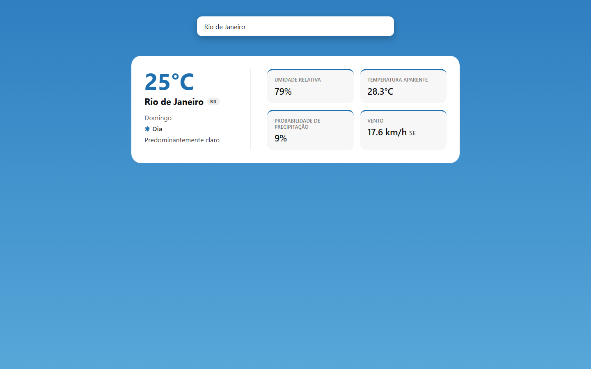
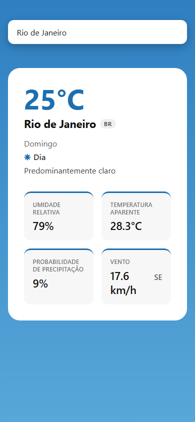
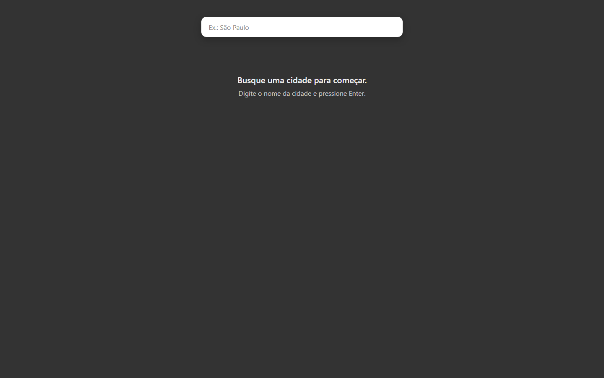
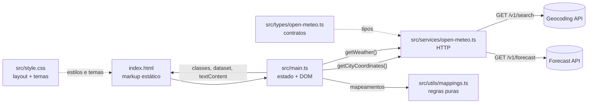
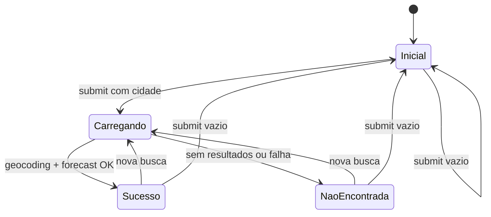

<div align="center">

# Clima

### Condições atuais de qualquer cidade, em uma interface que muda de cor conforme o tempo

[](https://www.typescriptlang.org/)
[](https://vite.dev/)
[](https://developer.mozilla.org/docs/Web/API/Document_Object_Model)
[](https://open-meteo.com/)
[](https://github.com/ivan-teotonio/app-clima/actions/workflows/deploy.yml)
[](#roadmap)

**TypeScript · Vite · HTML semântico · CSS puro · Open-Meteo**

</div>

<div align="center">
  
  <sub>Busca concluída: o fundo assume a paleta do clima atual (céu claro, de dia).</sub>
</div>

---

## Sobre o projeto

**Clima** é uma aplicação web que responde a uma pergunta simples: *"como está o tempo em …?"*.

O usuário digita o nome de uma cidade e recebe, em segundos, temperatura, sensação térmica, umidade, chance de precipitação e vento. Sem cadastro, sem chave de API e sem recarregar a página.

O projeto foi construído **do zero com Vanilla TypeScript**, sem frameworks de UI e **sem dependências de runtime**. Além do produto, o repositório documenta todo o processo de engenharia — ideação, PRD, quebra em tarefas e critérios de aceite — o que torna o código fácil de auditar, manter e evoluir.

> O código não usa `innerHTML` para montar a interface: todo o HTML vive no `index.html` e o TypeScript é responsável apenas por estado, eventos e conteúdo.

---

## Funcionalidades

| Recurso | Descrição |
|---|---|
| **Busca por cidade** | Campo único, centralizado e acessível por teclado (Enter para buscar). |
| **Geocoding + clima atual** | Converte o nome da cidade em coordenadas e consulta o clima daquela localização. |
| **Dados completos** | Temperatura, cidade/país, dia da semana, dia/noite, condição do céu, umidade, sensação térmica, probabilidade de precipitação e vento (velocidade + direção cardinal). |
| **Tema dinâmico** | 7 paletas (céu claro, nublado, neblina, garoa, chuva, neve e tempestade) com variação **dia/noite** — 14 combinações aplicadas ao fundo e à cor de destaque. |
| **Estados explícitos** | Empty state inicial, loading com spinner, sucesso, cidade não encontrada e fallback de erro. |
| **Reset inteligente** | Enviar o campo vazio limpa o resultado e volta ao estado inicial. |
| **Responsivo** | Sidebar e métricas empilham no mobile e ficam lado a lado a partir de 640px. |
| **Acessibilidade** | `label` associado, foco visível, `aria-live` no loading, conteúdo semântico e respeito a `prefers-reduced-motion`. |

---

## Preview

| Mobile | Estado inicial |
|:---:|:---:|
|  |  |

---

## Stack

| Tecnologia | Papel no projeto |
|---|---|
| **TypeScript** | Tipagem dos contratos da API, regras de negócio e manipulação segura do DOM. |
| **Vite** | Servidor de desenvolvimento com HMR e build de produção. |
| **HTML5** | Toda a estrutura da interface, com marcação semântica e acessível. |
| **CSS3** | Layout com Flexbox/Grid, variáveis CSS, temas por atributo, animações e media queries. |
| **[Open-Meteo](https://open-meteo.com/)** | APIs públicas de geocoding e forecast, sem necessidade de chave. |
| **GitHub Actions** | Build e deploy automáticos no GitHub Pages a cada push em `main`. |

> `package.json` contém apenas dependências de desenvolvimento (`vite` e `typescript`). Nada é enviado ao navegador além do código do próprio app.

---

## Arquitetura

O projeto segue uma separação em camadas: a interface não conhece a API, o service não conhece o DOM e as regras de transformação são funções puras.



### Camadas e responsabilidades

| Camada | Arquivo | Responsabilidade | Não faz |
|---|---|---|---|
| Estrutura | `index.html` | Markup, ids, textos, semântica e acessibilidade | Lógica ou requisições |
| Apresentação | `src/style.css` | Layout, cores, temas, animação e responsividade | Decidir estado |
| Contratos | `src/types/open-meteo.ts` | Formato dos payloads da API | Executar código em runtime |
| Comunicação | `src/services/open-meteo.ts` | Montar URLs, executar `fetch`, validar respostas | Tocar no DOM |
| Regras puras | `src/utils/mappings.ts` | Weather code → texto, graus → direção, data → dia da semana | Tocar no DOM ou buscar dados |
| Cérebro | `src/main.ts` | Ler input, orquestrar o fluxo, alternar estados, renderizar | Montar URL ou chamar `fetch` diretamente |

### Estrutura de pastas

```text
clima/
├── .github/
│   └── workflows/
│       └── deploy.yml         # CI/CD: build + deploy no GitHub Pages
├── index.html                 # toda a interface (markup estático)
├── vite.config.ts             # base do build para o GitHub Pages
├── src/
│   ├── main.ts                # orquestração, estados e renderização
│   ├── style.css              # layout, temas e animações
│   ├── services/
│   │   └── open-meteo.ts      # geocoding + forecast
│   ├── types/
│   │   └── open-meteo.ts      # contratos da API
│   └── utils/
│       └── mappings.ts        # regras de negócio puras
├── docs/
│   ├── brain-dump.md          # ideação e decisões iniciais
│   ├── prd.md                 # requisitos funcionais e técnicos
│   ├── tasks.md               # 17 tarefas com critérios de aceite
│   └── screenshots/
├── public/                    # favicon e ícones
└── package.json
```

---

## Fluxo da aplicação

A interface funciona como uma máquina de estados: o **resultado** exibido é sempre exclusivo (card **ou** empty state), e o loading entra como feedback adicional — sempre encerrado no `finally`.



1. O `<form>` dispara `submit` (Enter ou botão) e o handler chama `event.preventDefault()`.
2. O input é validado: vazio → `resetView()`; caso contrário → `isLoading = true` e spinner.
3. `getCityCoordinates()` busca latitude, longitude e timezone; sem resultado → empty state.
4. `getWeather()` busca o bloco `current`; sem dados → empty state.
5. Sucesso → tema aplicado no `<body>`, card revelado e dados renderizados.
6. `finally` desliga o loading **em todos os caminhos** (sucesso, falha ou exceção).

---

## Decisões de engenharia

1. **Sem framework de UI, por escolha.** O objetivo era dominar o DOM, o modelo de eventos e a organização de código sem esconder complexidade atrás de abstrações. O resultado é um bundle pequeno e um fluxo fácil de seguir.

2. **HTML estático como fonte da verdade.** O markup fica todo no `index.html`; o TypeScript só escreve `.textContent`, alterna classes e `data-*`. Isso mantém acessibilidade e semântica visíveis no arquivo de entrada e evita templates espalhados pelo código.

3. **Service layer obrigatória.** A UI nunca monta URL nem chama `fetch`. Se a API mudar de endpoint ou de contrato, a alteração fica concentrada em `services/` e `types/`.

4. **`null` para falhas esperadas, `catch` para o inesperado.** Geocoding sem resultado e forecast vazio retornam `null`, permitindo um fluxo previsível e sem exceções de controle. O `catch` cobre apenas falhas realmente inesperadas, sempre convergindo para uma mensagem amigável. O usuário nunca vê erro técnico.

5. **O TypeScript não conhece cores.** O tema é aplicado com `data-weather` e `data-daytime` no `<body>`; o CSS decide as paletas com variáveis (`--accent`) e gradientes. Trocar o visual não exige tocar na lógica.

6. **`.hidden` como utilitário único e última regra do CSS.** Os componentes definem `display: flex`; manter `.hidden` no fim do arquivo garante que ele vença por ordem de cascata e evita estados sobrepostos (card + empty state ao mesmo tempo).

7. **Duas requisições por busca.** Cada busca dispara no máximo duas chamadas sequenciais: geocoding e forecast. Não há polling nem chamadas redundantes.

8. **Acessibilidade desde o markup.** `label` (inclusive `sr-only`), `focus-visible`, `role="status"` + `aria-live` no loading, `aria-hidden` no spinner decorativo e `prefers-reduced-motion` para quem prefere menos animação.

---

## Como executar

### Requisitos

- **Node.js 22.12+** (ou 20.19+) e npm
- Navegador moderno com suporte a ES2023

### Instalação

```bash
# na raiz do projeto
npm install
npm run dev
```

A aplicação estará disponível em `http://localhost:5173` (ou na próxima porta livre).

### Scripts

| Comando | O que faz |
|---|---|
| `npm run dev` | Inicia o servidor de desenvolvimento com HMR. |
| `npm run build` | Roda `tsc` (checagem de tipos) e gera o build otimizado em `dist/`. |
| `npm run preview` | Serve localmente o build de produção em `http://localhost:4173/app-clima/`. |

> Não há variáveis de ambiente nem chave de API: o Open-Meteo é público e não exige autenticação.

---

## Deploy e CI/CD

O deploy é contínuo: todo push em `main` — ou uma execução manual — dispara o workflow [`.github/workflows/deploy.yml`](.github/workflows/deploy.yml), que:

1. instala as dependências com `npm ci`;
2. roda `npm run build` (`tsc` + Vite);
3. publica o conteúdo de `dist/` no GitHub Pages.

O [`vite.config.ts`](vite.config.ts) define `base: "/app-clima/"` no build, porque o GitHub Pages serve o projeto em um subdiretório. Em desenvolvimento a base continua `/`.

**URL:** https://ivan-teotonio.github.io/app-clima/

> **Primeiro deploy:** em *Settings → Pages → Build and deployment*, selecione **GitHub Actions** como source. Depois rode o workflow em *Actions → Deploy — GitHub Pages → Run workflow* (ou faça um novo push em `main`).

---

## API

O app consome dois endpoints públicos do [Open-Meteo](https://open-meteo.com/), sempre via `GET`:

| Etapa | Endpoint | Parâmetros principais |
|---|---|---|
| Geocoding | `https://geocoding-api.open-meteo.com/v1/search` | `name`, `count=1`, `language=pt`, `format=json` |
| Forecast | `https://api.open-meteo.com/v1/forecast` | `latitude`, `longitude`, `timezone`, `current=...` |

O forecast solicita as variáveis exibidas — `temperature_2m`, `relative_humidity_2m`, `apparent_temperature`, `is_day`, `wind_speed_10m`, `wind_direction_10m` e `precipitation_probability` — além de `precipitation` e `weather_code`, usados para completude dos dados e para o tema visual.

**Regras de negócio aplicadas no cliente:**

- Weather codes WMO → descrição em pt-BR (27 códigos mapeados);
- Graus do vento → direção cardinal (N, NE, E, SE, S, SW, W, NW);
- `is_day` (`1`/`0`) → indicador visual **☀ Dia** / **☾ Noite**;
- `current.time` → dia da semana via `Intl.DateTimeFormat("pt-BR")`;
- Weather code + `is_day` → paleta de cores do tema.

---

## Acessibilidade e responsividade

- **Teclado:** o formulário nativo garante busca com Enter; o foco é sempre visível.
- **Leitores de tela:** `label` associado ao input, `role="status"` + `aria-live="polite"` para o loading e `aria-hidden` no spinner decorativo.
- **Movimento:** o spinner desacelera quando o sistema pede `prefers-reduced-motion: reduce`.
- **Layout:** card com `max-width: 800px`, sidebar + conteúdo em linha no desktop e empilhados no mobile (breakpoint em `640px`).
- **Contraste:** fundo escuro com texto claro nos estados neutros e card branco com texto escuro na leitura dos dados.

---

## Qualidade e validação

O projeto não possui suíte de testes automatizados (está no roadmap). A validação atual combina checagem de tipos, build e um roteiro manual de aceite:

```bash
npm run build   # tsc + vite build
```

- [x] Busca válida exibe todos os dados obrigatórios;
- [x] Cidade inexistente cai no empty state, sem erro técnico;
- [x] Loading com spinner aparece durante as duas requisições;
- [x] Campo vazio limpa o resultado e volta ao estado inicial;
- [x] Tema de fundo e cor de destaque mudam conforme clima e dia/noite;
- [x] Layout funciona em desktop e mobile;
- [x] Build de produção conclui sem erros;
- [x] Pipeline de CI/CD builda e publica a cada push em `main`.

---

## Documentação do processo

Este repositório foi desenvolvido com documentação antes e durante o código:

| Documento | Conteúdo |
|---|---|
| [`docs/brain-dump.md`](docs/brain-dump.md) | Ideação, hipóteses e decisões iniciais. |
| [`docs/prd.md`](docs/prd.md) | Requisitos funcionais, técnicos, visuais e critérios de aceite. |
| [`docs/tasks.md`](docs/tasks.md) | 17 tarefas incrementais com critérios de aprovação. |

---

## Roadmap

- [ ] Previsão por hora e por dia;
- [ ] Geolocalização do usuário (GPS);
- [ ] Favoritos e histórico de buscas;
- [ ] Troca de unidades (°C/°F, km/h/mph);
- [ ] Testes automatizados (Vitest + Playwright);
- [ ] Preview de pull requests com deploy efêmero.

---

## Autor

**Ivan Teotônio** — desenvolvedor web com foco em TypeScript, Node.js e APIs REST.

[](https://github.com/ivan-teotonio)
[](https://www.linkedin.com/in/ivan-teot%C3%B4nio-2b5129195/)
[](mailto:ivanteotonio256@gmail.com)

---

<div align="center">
  <sub>Projeto desenvolvido para fins de estudo e portfólio.</sub>
</div>
